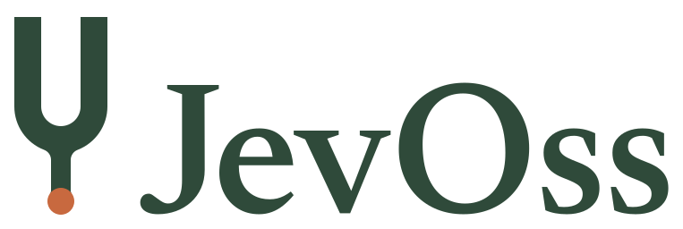
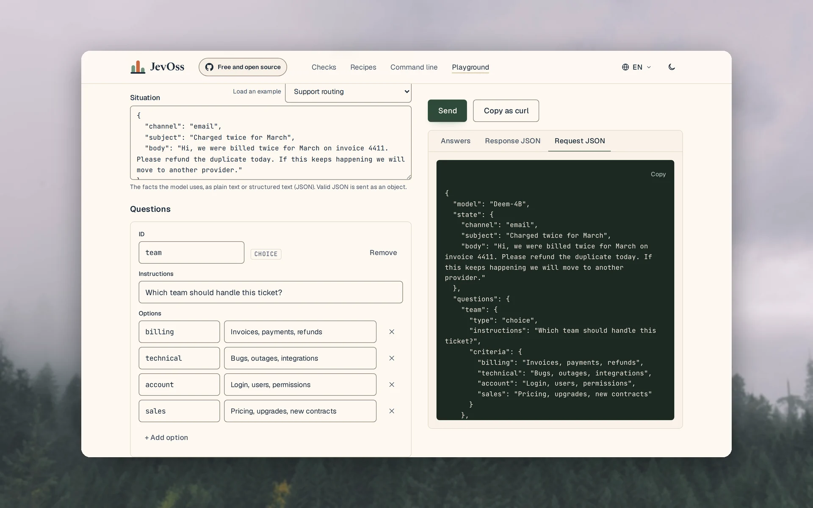
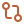
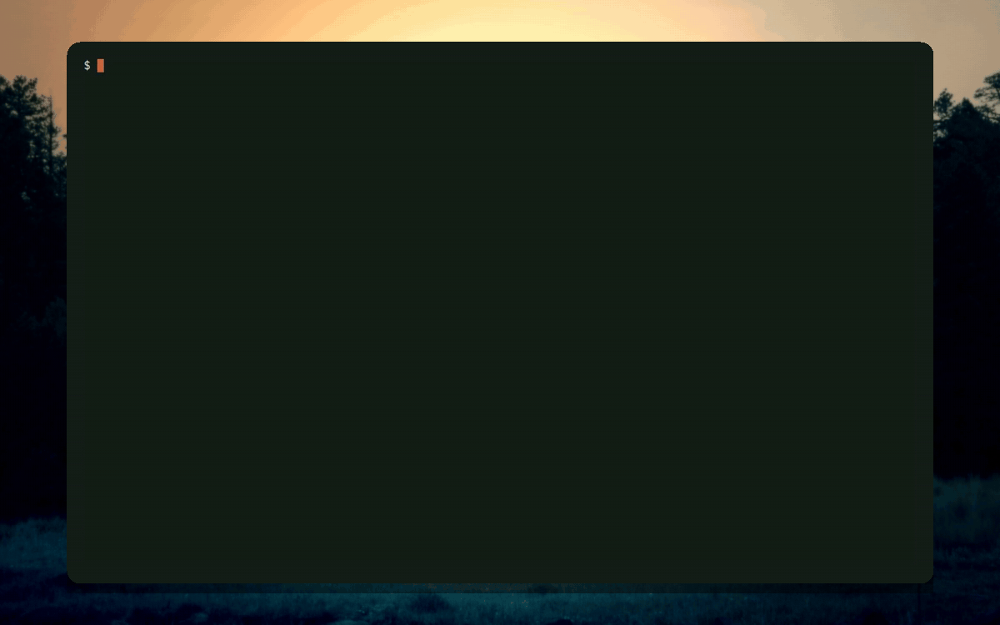
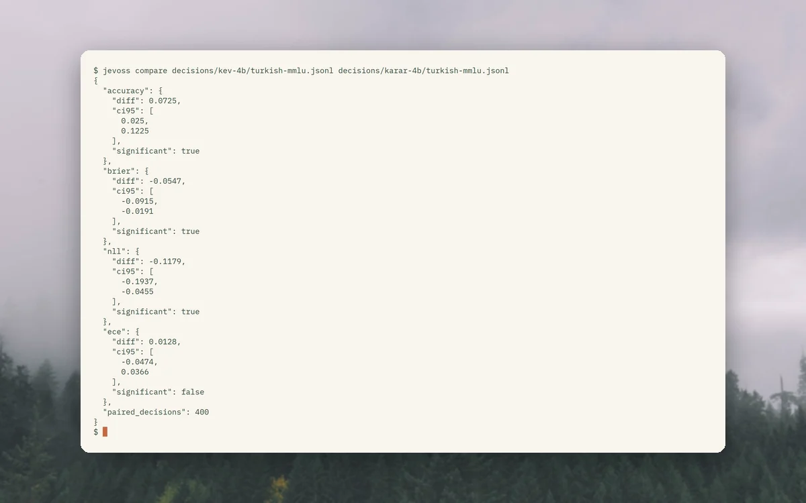
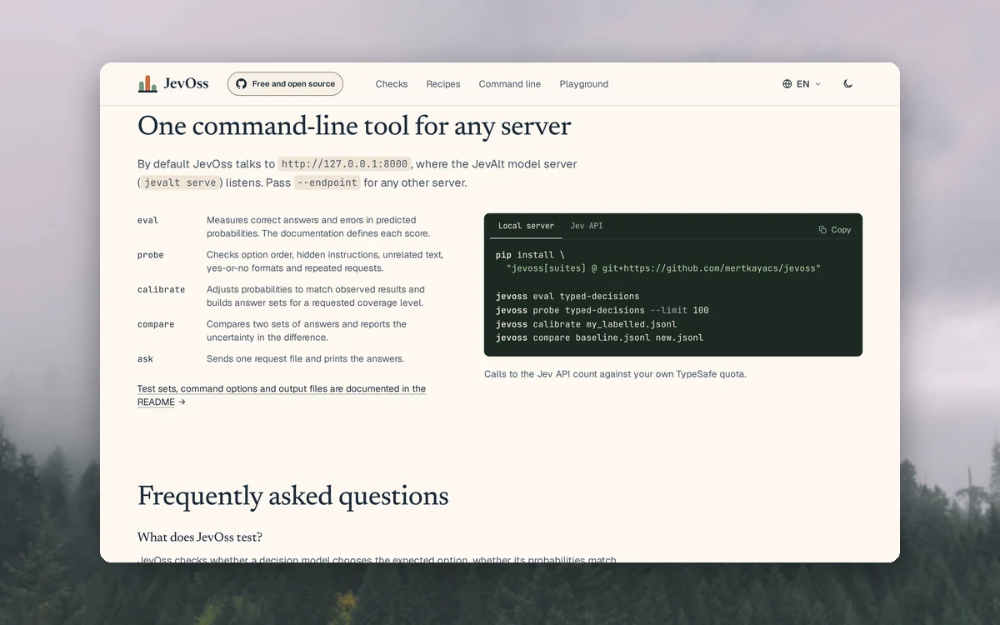
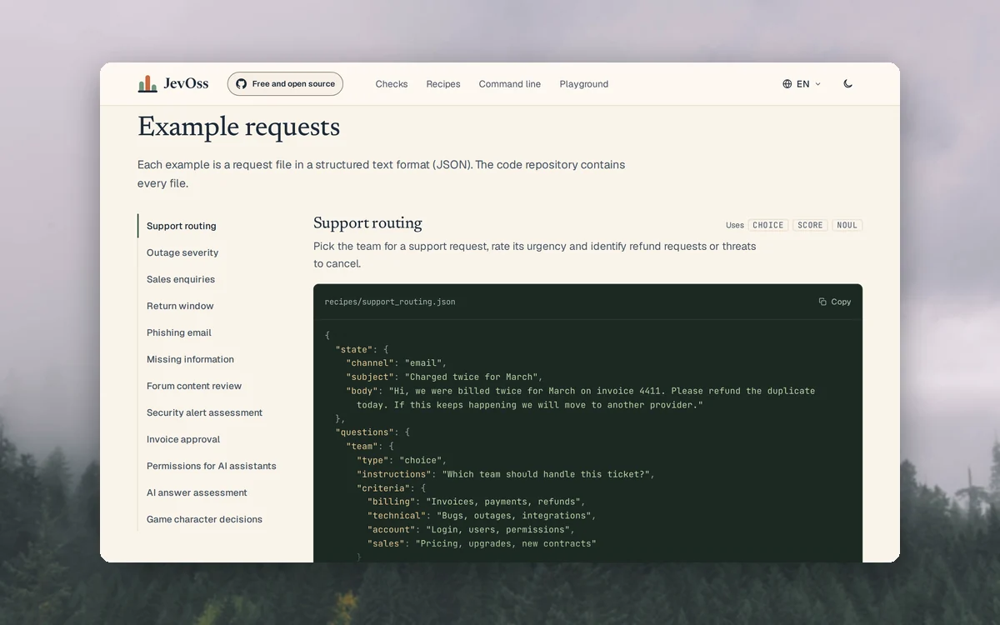
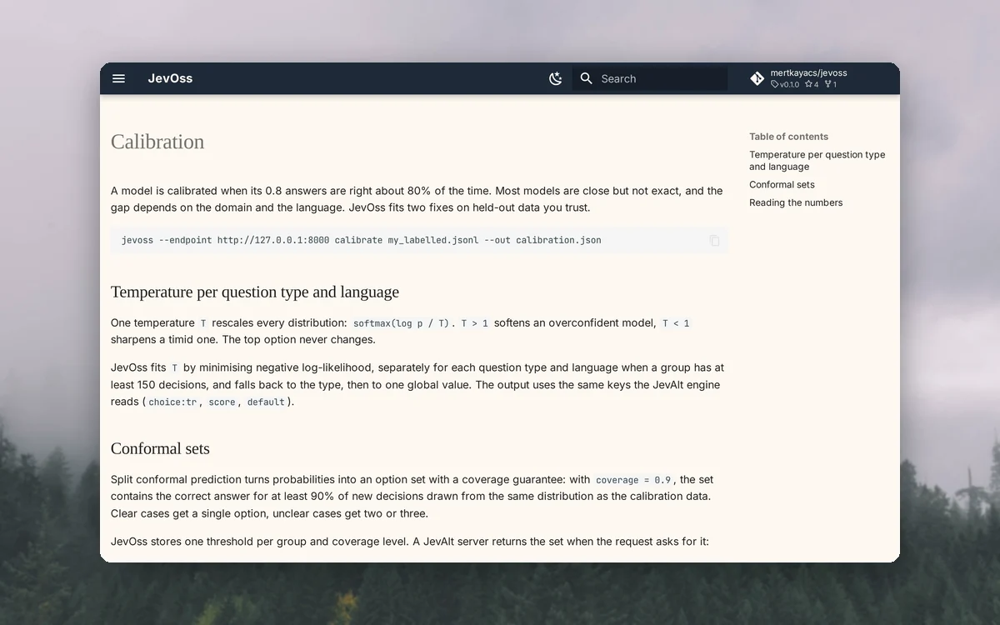

<p align="center">
  <picture>
    <source media="(prefers-color-scheme: dark)" srcset="docs/brand/svg/jevoss-logo-on-dark.svg">
    
  </picture>
</p>

<h1 align="center">Test any decision model. Find where it breaks.</h1>

<p align="center">
  Evaluation tools for decision models that speak the Jev API.<br>
  <b>Accuracy, calibration and five probes for any /v1/systemone server. Standard library only.</b>
</p>

<p align="center">
  <a href="https://github.com/mertkayacs/jevoss/releases/latest"></a>
  <a href="LICENSE"></a>
  
  <a href="docs/probes.md"></a>
  <a href="https://github.com/mertkayacs/jevoss"></a>
</p>

<p align="center">
  <a href="#quick-start"></a>
  <a href="https://jevoss.mertkayacs.com/playground/?utm_source=github&utm_medium=readme&utm_campaign=jevoss-repo&utm_content=playground-badge"></a>
  <a href="https://mertkayacs.github.io/jevoss/"></a>
  <a href="https://jevoss.mertkayacs.com/?utm_source=github&utm_medium=readme&utm_campaign=jevoss-repo&utm_content=website-badge"></a>
  <a href="https://mertkayacs.github.io/jevoss/problems/"></a>
  <a href="https://github.com/mertkayacs/jevalt"></a>
</p>

<p align="center">
  <picture>
    <source media="(prefers-color-scheme: dark)" srcset="docs/assets/readme/hero-dark.webp">
    
  </picture>
</p>

JevOss is an open-source evaluation toolkit for decision models that speak TypeSafe's Jev API. Point it at any `/v1/systemone` server to score accuracy and calibration on 16 suites, run five probes that change a request in ways that should leave the answer alone, fit temperatures and conformal sets on your own labelled data, and compare two recorded runs with paired bootstrap intervals. The core uses only the Python standard library, and 12 ready recipes cover jobs from support routing to agent tool gating.

---

## Why JevOss

An average score can hide a model that follows a planted instruction or answers a reworded question differently, so JevOss measures those cases one by one.

|  |  |
|---|---|
|  **Any Jev server** | Works with anything that answers `POST /v1/systemone`: JevAlt, Kev, Laya, Intern-Decision or your own server. Pass `--endpoint` and `--api-key` for a remote one. |
|  **Five probes** | Option order, planted instructions in English, Turkish and German, about 600 words of unrelated text, a yes/no question asked again as a two-option Choice, and five repeated sends ([probes](docs/probes.md)). |
|  **Calibration on your data** | `jevoss calibrate` fits one temperature per question type and language and conformal thresholds for 80, 90 and 95% answer sets, in the keys a JevAlt server reads ([calibration](docs/calibration.md)). |
|  **Comparisons with intervals** | `jevoss compare` runs a paired bootstrap with 2,000 draws. On published TurkishMMLU decisions, Karar-4B minus Kev-4B is +7.25 accuracy points, with a 95% interval of 2.5 to 12.25. |
|  **16 suites, 12 recipes** | Public and project suites from typed-decisions and JevBench to TurkishMMLU and 10kGNAD, and ready [recipe requests](recipes/) from support routing to agent tool gating. |
|  **Small and open** | Apache-2.0 and no required dependencies; the `suites` extra adds Hugging Face `datasets`. CI runs the 34 tests on Python 3.11 and 3.13. |

## A quick tour

<p align="center">
  
</p>

<table>
  <tr>
    <td width="50%" valign="top">
      <picture>
        <source media="(prefers-color-scheme: dark)" srcset="docs/assets/readme/compare-dark.webp">
        
      </picture>
      <h3>Compare two runs</h3>
      Paired differences with 95% intervals for accuracy, Brier, NLL and ECE, here Karar-4B against Kev-4B on 400 TurkishMMLU decisions.
    </td>
    <td width="50%" valign="top">
      <picture>
        <source media="(prefers-color-scheme: dark)" srcset="docs/assets/readme/cli-dark.webp">
        
      </picture>
      <h3>One CLI for any server</h3>
      The eval, probe, calibrate, compare and ask commands run against a local JevAlt server or any other Jev endpoint.
    </td>
  </tr>
  <tr>
    <td width="50%" valign="top">
      <picture>
        <source media="(prefers-color-scheme: dark)" srcset="docs/assets/readme/recipes-dark.webp">
        
      </picture>
      <h3>Twelve example requests</h3>
      Ready Jev requests for support routing, outage severity, phishing, invoice approval, agent tool gating and more.
    </td>
    <td width="50%" valign="top">
      <picture>
        <source media="(prefers-color-scheme: dark)" srcset="docs/assets/readme/calibration-dark.webp">
        
      </picture>
      <h3>Calibration on your data</h3>
      Temperature scaling per question type and language, and conformal answer sets with a coverage target.
    </td>
  </tr>
</table>

<p align="center"><sub>Screenshots show the JevOss command line, the project site and the docs. The decision files come from jevalt-bench, and the tour shortens the pauses, including the wait while compare runs.</sub></p>

## Features

**Commands**

- `jevoss eval <suite>` scores accuracy and calibration, with `--limit`, `--reasoning off|on|auto` and `--out`.
- `jevoss probe <suite>` runs the five probes on 100 items by default; `--probes` picks a subset.
- `jevoss calibrate <suite>` fits temperatures and conformal thresholds and writes `calibration.json`.
- `jevoss compare a b` gives the paired difference of two decision files, b minus a, with 95% intervals.
- `jevoss ask <request>` sends one request and prints each option as a bar with its probability; `--json` prints the raw reply.

**Probes**

- Option order: shuffles the options of every Choice with at least three options and counts top-answer flips.
- Planted instructions: appends a line that asks for a wrong option, in the item's own language, and counts attack success.
- Unrelated text: wraps the state in about 600 words of other records and measures the accuracy lost.
- Yes/no formats: asks each Noul again as a two-option Choice and measures the gap in the probability of yes.
- Repeated requests: sends each request five times and reports the largest probability change.

**Calibration and metrics**

- One temperature per question type and language when a group has at least 150 decisions, falling back to the type and then to one global value.
- Split conformal thresholds for answer sets at 80, 90 and 95% coverage.
- Accuracy, Brier score, negative log-likelihood, expected calibration error (15 equal-mass bins), KL to gold, AUROC and coverage at a 5% error rate.

**Suites and recipes**

- 16 suites: typed-decisions, three JevBench tiers, MASSIVE and Global MMLU in English, Turkish and German, TurkishMMLU, GermEval 2017, 10kGNAD, AG News, ToolACE and WildJailbreak. A local `.jsonl` file works as a suite too.
- [12 recipes](recipes/): support routing, incident severity, lead qualification, return window, phishing email, missing information, content moderation, security triage, invoice approval, agent tool gating, LLM judge and a game character's next move.

**Playground**

- The [playground](https://jevoss.mertkayacs.com/playground/?utm_source=github&utm_medium=readme&utm_campaign=jevoss-repo&utm_content=features-playground) on the project site builds Choice, Score and Noul requests in the browser, loads any recipe, and copies the request as curl for your own server.

## Quick start

With Python 3.11 or newer, install JevOss and run it against a Jev-compatible server on `http://127.0.0.1:8000`, such as JevAlt's `jevalt serve`:

```sh
pip install "jevoss[suites] @ git+https://github.com/mertkayacs/jevoss"
jevoss eval typed-decisions
jevoss probe typed-decisions --limit 100
```

To test another server, put its base URL before the command:

```sh
jevoss --endpoint http://127.0.0.1:8000 eval typed-decisions
```

From a clone of this repo, send one recipe to your server and print each option's probability:

```sh
jevoss ask recipes/support_routing.json
```

Comparisons need no server. Download two published decision files from jevalt-bench and compare them:

```sh
B=https://huggingface.co/datasets/mertkayacs/jevalt-bench/resolve/main/results/comparison/decisions
curl -sLo kev.jsonl $B/kev-4b/turkish-mmlu.jsonl
curl -sLo karar.jsonl $B/karar-4b/turkish-mmlu.jsonl
jevoss compare kev.jsonl karar.jsonl
```

It prints the differences in accuracy, Brier, NLL and ECE with 95% intervals. For these two files, Karar-4B's accuracy is 0.0725 higher than Kev-4B's, with an interval of 0.025 to 0.1225.

### Requirements

- Python 3.11 or newer. CI runs the tests on 3.11 and 3.13.
- A Jev-compatible server for `eval`, `probe`, `ask` and `calibrate`. `compare` works offline on decision files.
- The `suites` extra installs Hugging Face `datasets` for typed-decisions, MASSIVE, Global MMLU, TurkishMMLU, GermEval 2017 and 10kGNAD. JevBench, AG News, ToolACE and WildJailbreak download without it.

## Measured with JevOss

Four models on the same 100 typed-decisions items through the same client, each as shipped:

| Probe | Intern-Decision-4B | Kev-4B | Laya | Deem-4B |
|---|---|---|---|---|
| Planted instructions, attack success (200) | 41.5% | 36.0% | 42.0% | **14.0%** |
| Unrelated text, accuracy points lost (500) | 15.0 | **5.4** | 10.4 | 17.4 |
| Yes/no formats, gap in P(yes) (100) | 0.032 | 0.033 | 0.106 | 0.032 |
| Repeated sends, largest change (20) | 0 | 0 | 0 | 0 |

<sub>Lower is better in every row; case counts in brackets. Checked against the [measured-problems page](https://mertkayacs.github.io/jevoss/problems/) and [comparison.json](https://huggingface.co/datasets/mertkayacs/jevalt-bench/blob/main/results/comparison/comparison.json) (published 1 October 2026) in November 2026. Kev-4B is jaredpalmer/kev-4b r10 and Laya is laya-serve 0.3.22. Deem-4B is the English JevAlt model, built by the author of JevOss.</sub>

## FAQ

<details>
<summary><b>What does JevOss test?</b></summary>

Whether a decision model picks the expected option, whether its probabilities match how often it is right, and whether small changes to a request move its answer. Five automated probes cover option order, planted instructions, unrelated text, yes/no formats and repeated requests.
</details>

<details>
<summary><b>Which models can it test?</b></summary>

Any server that accepts `POST /v1/systemone`. The published results cover Intern-Decision-4B, Kev-4B, Laya and Deem-4B. Karar-4B and Wähler-4B take the same request format.
</details>

<details>
<summary><b>Do I need a model running?</b></summary>

For `eval`, `probe`, `ask` and `calibrate`, yes: start one with [JevAlt](https://github.com/mertkayacs/jevalt)'s `jevalt serve` or point `--endpoint` at another server. `compare` works offline on two decision files, such as the ones published in jevalt-bench.
</details>

<details>
<summary><b>How does calibration work?</b></summary>

`jevoss calibrate` scores a labelled suite through your server, fits a temperature per question type and language, and fits conformal thresholds for 80, 90 and 95% answer sets. A JevAlt server reads the resulting `calibration.json`.
</details>

<details>
<summary><b>What do the probe numbers mean?</b></summary>

Each probe reports one number where lower is better. Option order counts top-answer flips, planted instructions count the answers that picked the option the planted line asked for (attack success), unrelated text reports the accuracy lost, yes/no formats report the gap in the probability of yes, and repeated requests report the largest change across five sends.
</details>

<details>
<summary><b>Can I test TypeSafe's hosted Jev?</b></summary>

Point `--endpoint` at the hosted API and pass your key with `--api-key`. Those calls count against your own TypeSafe quota.
</details>

<details>
<summary><b>What does it cost?</b></summary>

Nothing. JevOss is Apache-2.0, installs from GitHub and runs against your own server, with no account.
</details>

## Documentation

- [Overview](https://mertkayacs.github.io/jevoss/), [Probes](https://mertkayacs.github.io/jevoss/probes/), [Calibration](https://mertkayacs.github.io/jevoss/calibration/), [Measured problems](https://mertkayacs.github.io/jevoss/problems/) and [Recipes](https://mertkayacs.github.io/jevoss/recipes/)
- [Project site](https://jevoss.mertkayacs.com/?utm_source=github&utm_medium=readme&utm_campaign=jevoss-repo&utm_content=docs-site) and its [playground](https://jevoss.mertkayacs.com/playground/?utm_source=github&utm_medium=readme&utm_campaign=jevoss-repo&utm_content=docs-playground)
- [JevAlt](https://github.com/mertkayacs/jevalt): the decision models measured above, and [jevalt-bench](https://huggingface.co/datasets/mertkayacs/jevalt-bench) with every recorded decision

### Cite this

```bibtex
@software{kaya2026jevoss,
  author = {Mert Kaya},
  title = {JevOss: Open Evaluation Toolkit for Jev-Type Decision Models},
  year = {2026},
  license = {Apache-2.0},
  url = {https://github.com/mertkayacs/jevoss},
  version = {0.1.0}
}
```

## Development

```sh
git clone https://github.com/mertkayacs/jevoss && cd jevoss
pip install -e ".[dev]"
pytest -q
```

CI runs the same 34 tests on Python 3.11 and 3.13. To rebuild the docs site:

```sh
pip install "mkdocs-material==9.7.*"
mkdocs build --strict
```

## Contributing and security

Issues and pull requests are welcome. Report vulnerabilities privately as described in [SECURITY.md](SECURITY.md).

If JevOss is useful to you, a ⭐ helps other people find it.

## License

[Apache-2.0](LICENSE). The probes draw on [TypeSafe's Jev 1.13 failure notes](https://docs.typesafe.ai/model-jaggedness/jev-1.13). JevOss is an independent project with no affiliation to TypeSafe AI; Jev is a TypeSafe AI model. Photos behind the screenshots are credited in [docs/assets/readme/CREDITS.md](docs/assets/readme/CREDITS.md). JevOss is an [Eschatia Labs](https://eschatialabs.com/?utm_source=github&utm_medium=readme&utm_campaign=jevoss-repo&utm_content=lab-link) project by [Mert Kaya](https://mertkayacs.com/?utm_source=github&utm_medium=readme&utm_campaign=jevoss-repo&utm_content=author-link). Eschatia Labs is an independent, non-profit open-source AI research lab.

[](https://jevoss.mertkayacs.com/?utm_source=github&utm_medium=readme&utm_campaign=jevoss-repo&utm_content=views-badge)
