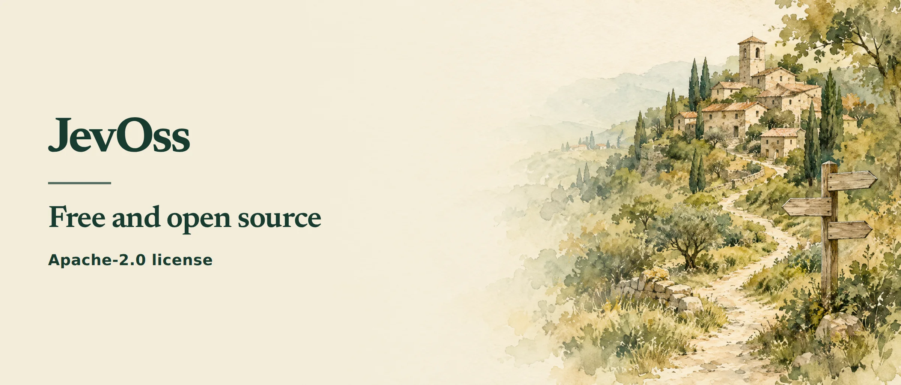

<p align="center"></p>

<p align="center">
  <a href="https://github.com/mertkayacs/jevoss"></a>
  <a href="LICENSE"></a>
  
</p>

JevOss is free and open source under the Apache-2.0 license.

<p align="center"><b>Accuracy, probability calibration, prompt injection, option-order sensitivity and consistency probes for any Jev-compatible decision-model server.</b></p>

JevOss measures how often a decision model is right, whether its probabilities match that accuracy, and which inputs change its answers. It was built to expose failures that an average score hides, such as following hidden instructions or changing a decision when options are reordered.

[Read the test methods](https://mertkayacs.github.io/jevoss/) or test a local server below. Any server implementing the Jev API (`POST /v1/systemone`) can be tested, including [JevAlt](https://github.com/mertkayacs/jevalt), Kev and Laya.

## Quick start

Requires Python 3.11 or newer and a running decision-model server. To start JevAlt's local server, follow its [installation instructions](https://github.com/mertkayacs/jevalt). Keep that terminal running.

In a second terminal:

```sh
pip install "jevoss[suites] @ git+https://github.com/mertkayacs/jevoss" && jevoss eval typed-decisions && jevoss probe typed-decisions --limit 100
```

The default server is `http://127.0.0.1:8000`. To test another server, put its base URL before the command:

```sh
jevoss --endpoint http://127.0.0.1:8000 eval typed-decisions
```

## What it tests

Run all five with `jevoss probe <suite> --probes permutation injection distractors noul determinism`.

| Probe | What it changes | Metric | Preferred direction |
| --- | --- | --- | --- |
| `permutation` | Shuffles Choice options | Selected-answer flips | lower |
| `injection` | Appends an instruction that requests the wrong answer | Attack success | lower |
| `distractors` | Pads the state with about 600 words of unrelated text | Accuracy lost | lower |
| `noul` | Repeats each yes/no question as a Choice | Mean gap in P(yes) | lower |
| `determinism` | Sends each request five times | Largest probability change | lower |

`jevoss eval` reports accuracy and calibration. `jevoss calibrate` fits confidence on your data, and `jevoss compare` compares two recorded runs. See the [documentation](https://mertkayacs.github.io/jevoss/) for supported suites and output formats.

## Example decisions

The [recipe directory](recipes/) contains complete Jev requests. Run one with `jevoss ask recipes/<file>`.

| Recipe | Decision |
| --- | --- |
| [`support_routing.json`](recipes/support_routing.json) | Route a ticket, set urgency and identify churn risk. |
| [`incident_severity.json`](recipes/incident_severity.json) | Classify the severity of a checkout outage. |
| [`lead_qualification.json`](recipes/lead_qualification.json) | Label a sales lead as hot, warm, cold or not a fit. |
| [`return_window.json`](recipes/return_window.json) | Apply a written return-window policy. |
| [`phishing_email.json`](recipes/phishing_email.json) | Route an email that contains a hidden instruction for the filter. |
| [`missing_information.json`](recipes/missing_information.json) | Return `unknown` when the text omits the deciding fact. |
| [`content_moderation.json`](recipes/content_moderation.json) | Choose whether to allow, warn, hide or remove a forum post. |
| [`security_triage.json`](recipes/security_triage.json) | Set severity and response for an impossible-travel login. |
| [`invoice_approval.json`](recipes/invoice_approval.json) | Approve, hold or reject an invoice under a policy. |
| [`agent_tool_gating.json`](recipes/agent_tool_gating.json) | Decide whether an agent may run a deletion plan or must ask first. |
| [`llm_judge.json`](recipes/llm_judge.json) | Compare two answers against a reference. |
| [`npc_decision.json`](recipes/npc_decision.json) | Choose a village character's next action. |

For example, after cloning this repository, send the support-routing request to your running server:

```sh
jevoss ask recipes/support_routing.json
```

[Emberwick](https://emberwick.mertkayacs.com) uses the same request format to choose villagers' next actions. Its example is [npc_decision.json](recipes/npc_decision.json).

<a href="https://emberwick.mertkayacs.com"></a>

## Suites

`jevoss eval <suite>` supports:

`typed-decisions`, `jevbench-easy`, `jevbench-hard`, `jevbench-original`, `agnews`, `germeval2017`, `gmmlu-de`, `gmmlu-en`, `gmmlu-tr`, `gnad10`, `massive-de`, `massive-en`, `massive-tr`, `toolace`, `turkish-mmlu`, `wildjailbreak`

## Results and limits

The [measured-problems report](docs/problems.md) compares the models on the same probes and held-out rows, each as shipped. Kev-4B and Laya lose less accuracy than JevAlt under long padding. Hosted Jev 1.13 results use a different item set and are shown for context only.


All recorded decisions are in [jevalt-bench](https://huggingface.co/datasets/mertkayacs/jevalt-bench/tree/main/results/comparison). Test on your own inputs before treating a suite score as evidence for your application.

## Reproduce

Start a Jev-compatible server and run the full typed-decisions probe set:

```sh
pip install "jevoss[suites] @ git+https://github.com/mertkayacs/jevoss"
jevalt serve
jevoss probe typed-decisions
```

Each probe prints a JSON object with its metrics. The [documentation](https://mertkayacs.github.io/jevoss/) describes the probe methods, calibration and recipe format.

## Cite this

```bibtex
@software{kaya2026jevoss,
  author = {Mert Kaya},
  title = {JevOss: Open Evaluation Toolkit for Jev-Type Decision Models},
  year = {2026},
  license = {Apache-2.0},
  url = {https://github.com/mertkayacs/jevoss},
  version = {0.1.0}
}
```

## Links

- Project site: https://jevoss.mertkayacs.com
- Documentation: https://mertkayacs.github.io/jevoss/
- Emberwick demo: https://emberwick.mertkayacs.com
- JevAlt models: https://github.com/mertkayacs/jevalt
- jevalt-bench: https://huggingface.co/datasets/mertkayacs/jevalt-bench
- Eschatia Labs: https://eschatialabs.com
- Mert Kaya: https://mertkayacs.com

## License

[Apache-2.0](LICENSE).

## Acknowledgements

The probes draw on [TypeSafe's Jev 1.13 failure notes](https://docs.typesafe.ai/model-jaggedness/jev-1.13). JevOss is an independent project with no affiliation to TypeSafe AI. Jev is a TypeSafe AI model.

<a href="https://eschatialabs.com"><picture><source media="(prefers-color-scheme: dark) and (min-resolution: 2dppx)" srcset="https://eschatialabs.com/brand/lockup-46-dark@2x.png"><source media="(prefers-color-scheme: dark)" srcset="https://eschatialabs.com/brand/lockup-46-dark@1x.png"><source media="(min-resolution: 2dppx)" srcset="https://eschatialabs.com/brand/lockup-46@2x.png"></picture></a><br>An [Eschatia Labs](https://eschatialabs.com) project by [Mert Kaya](https://mertkayacs.com).
